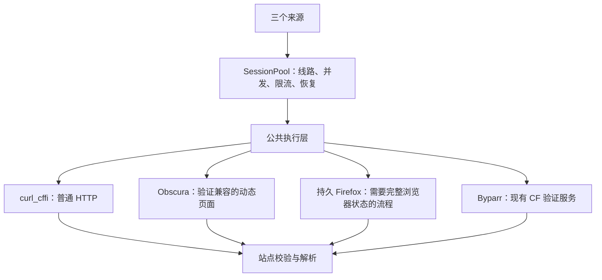

# 浏览器执行层与镜像瘦身方案

调研日期：2026-11-14（北京时间）。本文件是实施前方案，不表示已完成引擎迁移、镜像构建或线上验收。

## 1. 目标与结论

本次优先目标是减小爬虫镜像、降低更新成本，并改善 x1080x 浏览器验证及会话接管的稳定性。Sehuatang、Javbee、x1080x 复用公共执行能力，按站点和请求用途选择 HTTP、Obscura 或完整 Firefox。

已核实：

- 当前爬虫 Docker 构建打包的是 invisible-playwright 的 Firefox，并非 Chromium。两套 Actions 都设置了 `WITH_X1080X_BROWSER=true`。
- 当前公开 Byparr `latest` 的 amd64 镜像对应稳定版 v3.1.1，使用 invisible-playwright 0.45.0、invisible-core 55.50.0 和 Playwright 1.64.1。主分支已有更新，不能用主分支依赖替代稳定镜像的依赖证据。
- “Byparr 使用 Firefox 系运行时”成立；把当前版本称为 Camoufox 不准确。当前稳定源码直接使用 `InvisiblePlaywright`，不是 Camoufox。
- Obscura 是独立浏览器引擎，适合验证为轻量动态抓取后端；其 v0.2.7 官方文档明确不覆盖 Cloudflare 交互式挑战和验证码，不能据此移除完整浏览器路径。
- 保留 Byparr 时，部署仍然包含 Firefox。目标是减少重复打包和启动完整浏览器，而不能声称整体部署彻底不需要 Firefox。

## 2. 镜像体积证据

以下为公开镜像仓库返回的 **linux/amd64 压缩层大小之和**，不是解压后的磁盘占用、运行内存或当前服务器实际拉取的镜像。未下载镜像层、未连接生产服务器。

| 镜像 | 压缩层合计 | 版本证据 |
| --- | ---: | --- |
| `cxsz16888/sehuatang:v2` | 522.49 MiB | revision `b9c6e96860bf8104e4c67347dfe889585053e537`，北京时间 11 月 8 日构建 |
| `ghcr.io/thephaseless/byparr:latest` | 970.58 MiB | `VERSION=v3.1.1`，revision `b041dd2998110fc61789ae65e2506bd5b79edba5` |
| `h4ckf0r0day/obscura:latest` | 94.24 MiB | 无版本/revision 标签，北京时间 11 月 1 日推送，不能认定为 v0.2.7 |

对应平台 manifest digest：

```text
sehuatang:v2
sha256:680f6069770242c85ab2b823604df483e64caba04f44a874a56ed12c5cf5f79e

byparr:latest
sha256:8170ab7b32d8df29b4b74f02707c503f5bd404c4f99d7e28972bef1595e59c66

obscura:latest
sha256:956204fdb652e05df34a418d4ba23034e0019c3b08638ca256c29d085d6eafd7
```

将镜像 config 的非空 history 步骤与 manifest 层逐一对应，得到爬虫镜像中的两个大层：

| 构建步骤 | 压缩大小 |
| --- | ---: |
| 安装 Xvfb、字体、GTK、OpenGL 等运行库，同时安装 CA 证书 | 172.63 MiB |
| `python -m invisible_playwright fetch` 及浏览器缓存权限设置 | 270.48 MiB |
| 合计 | 443.11 MiB，约占镜像 84.8% |

两个层不能直接等同为最终可删除字节：瘦镜像仍需要 CA 证书，Python 依赖也会变化。它们说明浏览器相关依赖是当前主镜像体积的主要来源。新的镜像大小需要实际构建测量，不能用完整爬虫 522 MiB 与单独 Obscura 服务 94 MiB 相减得出收益。

Byparr 还存在一个约 303.87 MiB 的独立层，对应后置的 `chmod -R o+rX /app`、`chmod -R a+rwX /cache ...`。这是值得单独复核的构建优化点；优先研究在创建/复制文件时设置正确所有权和权限，避免后续大范围权限操作。尚未重建或比较层内容，不把整层承诺为可直接消除的收益。

## 3. 指纹与 Byparr 能力边界

Byparr v3.1.1 的 `src/utils.py:get_browser` 使用 `InvisiblePlaywright(headless=True, proxy=..., humanize=True, locale=..., timezone=...)`，为每次 API 请求创建 browser/context/page，在请求结束后关闭浏览器。

`src/endpoints.py` 从浏览器请求头提取真实的 `user-agent` 返回为 `solution.userAgent`。不应自行拼接或固定猜测浏览器 UA。

需要区分三个层次：

1. Firefox 内核家族。
2. 实际浏览器版本和会话的 UA、语言、时区等属性。
3. `curl_cffi` 的 TLS/HTTP impersonation 模板。

当前示例里的 `firefox147` 只是第 3 项，不代表 Byparr 实际运行 Firefox 147，更不能代替完整浏览器环境。同属 Firefox 家族也不能证明会话接管必然成功。

Obscura 使用另一套浏览器身份与网络实现。把 Byparr 返回的 Cookie/UA 导入 Obscura，不会自动使其变成 Firefox，也不保证 Cloudflare 接受这种接管。需要固定出口、验证实际 UA 和请求环境，并使用真实业务响应判断接管是否成功。

Byparr v3.1.1 的 `LinkRequest` 未提供输入 Cookie、持久 session ID 或完整账号操作的合同。现有公共客户端虽然为兼容服务发送 `cookies` 字段，不能据此假设 Byparr 会导入它。不能把其 `/v1` 当成持久账号浏览器或远程 Playwright 接口。

另外，Byparr 的启动和代理请求涉及 GeoIP/出口查询；这部分耗时需与浏览器启动、挑战等待、页面加载分别观测，避免把所有延迟都归因于浏览器内核。

## 4. 执行层方案

保留 `SessionPool`、公共限流/恢复、失败台账、解析器和存储合同；在公共会话层增加必要的浏览器执行适配。



执行器需要区分原始 HTML/JSON、渲染后的 HTML 和原始二进制内容，统一返回状态码、最终 URL、响应头、字节与耗时。torrent 下载不能使用 `page.content()` 替代，也不能误按 HTML 文本解码。

浏览器会话按“来源 + 固定代理线路 + 游客/账号身份 + 引擎”隔离。初版浏览器会话串行执行，在独立线程/同一事件循环中创建、使用和关闭，不让多个 HTTP worker 并发操纵同一个 page。

Obscura 通过 Python Playwright 的 `chromium.connect_over_cdp()` 接入，不需要给定时采集引入 MCP 或大模型决策。

Obscura v0.2.7 的 CDP `Target.createBrowserContext` 处理未读取 `proxyServer`；context 继承既有代理。初版按固定代理启动进程，不假设一个服务实例可以通过新建 context 随意更换代理。不同持久身份使用独立进程及 profile，不能让游客和账号共用同一个持久化目录。

## 5. 镜像与部署调整

### 5.1 第一阶段：完成小范围验证，保持现有可用能力

- 固定 Obscura v0.2.7 源码/发行件，选择明确包含 `render,stealth` 的构建，不直接把当前 Docker Hub `latest` 当作该版本。
- 官方 v0.2.7 Dockerfile 仅启用 `render`，CLI 默认 features 为空。运行时添加 `--stealth` 不能代替编译期启用 stealth。
- 保留当前浏览器镜像作为基线，测试 Obscura 的动态页面、代理、Cookie、连续翻页与账号状态兼容性。
- 不预设 Byparr 的 Firefox Cookie 可以稳定交给 Obscura；CF 交互式挑战仍按完整浏览器能力处理。

### 5.2 第二阶段：主爬虫镜像去除完整浏览器

目标部署为“轻量爬虫 + Obscura + 保留的 Byparr”。只有 x1080x 列表和账号流程均有可验收的执行去向后，才将主镜像切换为不含完整 Firefox 的默认构建。

现成的 `WITH_X1080X_BROWSER=false` 只是构建开关，不是完整迁移：缺少运行时后，公开列表会依配置回退 Byparr，账号浏览器登录则不可用。不能仅修改 Actions 参数就发布成替代版本。

如果 x1080x 的账号/列表仍需要持久 Firefox：

- 将它放到专门的浏览器执行服务，主爬虫只保留驱动端。
- 浏览器服务与 Byparr 尽量复用相同的固定浏览器运行时基础镜像，让 Docker 可以复用相同层，减少两份 Firefox 的存储和拉取。
- 独立进程或容器仍会消耗各自的运行内存；共享镜像层不等于共享浏览器进程。
- 需要实现并验收受控的持久会话接口；这不是原版 Byparr 已经提供的能力，不假设其支持 CDP 或任意账号操作。

如果 Obscura 无法承担足够多的目标页面，不为了统一使用引擎而强制上线。减少主镜像内重复的完整浏览器运行时，本身可以独立推进。

### 5.3 第三阶段：按数据优化 Byparr 构建

保留 Byparr 的业务职责，单独比较原镜像和优化构建的层大小。重点复核后置递归权限调整、安装时依赖分组和缓存。优化版必须使用相同浏览器版本执行启动及验证回归，不能以删除必要系统库或浏览器文件换取体积下降。

服务固定版本/digest。CDP、浏览器执行接口与 profile 仅向受控内部网络开放，凭据不写入日志、方案或镜像；profile 不跨身份共享。

## 6. x1080x 稳定性重点

- 已有公开列表游客 browser/context/page 复用，保留这一能力，不重复建设。
- 当前账号登录会关闭浏览器，再导出 Cookie/UA 交给 HTTP；优先对照测试“同一账号浏览器中持续执行 API”和现有 HTTP 接管，确认故障发生位置。
- 浏览器账号状态保持、公开游客状态保持相互独立，游客验证不得覆盖账号/CSRF。
- 保留 `cookie/auto/http/browser/disabled` 的授权语义。手动 Cookie 模式不能自动变成账号密码登录。
- 列表以真实列表、正确页码、有效资源 ID 为完成条件；账号以服务端 `authenticated=true` 为条件。HTTP 200 或标题正确不是验收证据。
- 网络错误、CF、BrowserPass、限流、账号过期和权限不足分别处理；设置本轮验证总时间与恢复次数，不串联所有引擎反复访问。
- 保留零价格/零配额附件规则、固定幂等键、原始 torrent 字节及大小限制。dry-run 不领取、不下载、不入库、不通知、不推进检查点。
- 原有逐页保存、失败台账与检查点语义继续沿用，本次不需要数据库模型变更。

## 7. 速度与资源验收

镜像体积、拉取时间、进程冷启动、页面请求延迟和整轮抓取耗时分别测量。Obscura 可能改善浏览器启动与内存开销，但当前 x1080x 的请求间隔、站点延迟和 CF 等待不会随引擎变化消失。HTTP 已能取得正确页面时，不默认改用浏览器。

固定站点、代理出口和限速，按顺序对比，避免两个测试同时增加同一出口负载。先测公开页面，再测有效账号的只读状态和预览；正常领取链路单独验收。

需要记录：

- 镜像每个平台的压缩大小、解压后逻辑大小、同机各镜像共享层后的实际磁盘占用。
- 冷启动耗时、首次成功页耗时、稳定会话页面 p50/p95、整轮耗时。
- 业务页面有效率、CF/BrowserPass 比例、会话接管成功率、限流比例、恢复次数。
- 空闲及运行时容器内存峰值、CPU、持续运行中的内存增长和浏览器重启次数。
- Byparr 调用频率及其浏览器启动、出口查询、验证和 networkidle 等待耗时。

小范围原型通过后，再做连续分页和至少 24 小时会话观察；不能用一次页面成功承诺长期稳定。浏览器验证超时不追加全引擎/多出口无限重试；普通网络故障保留已有的有界重试和线路恢复。限流、明确封锁和权限不足继续按各自语义处理。

## 8. 实施 TODO

- [x] 核对当前爬虫镜像构建链与浏览器家族。
- [x] 核对 Byparr 稳定版、当前公开镜像 revision、依赖及 UA 返回路径。
- [x] 查询公开镜像压缩大小，并对应主要构建层。
- [x] 核对 Obscura 的 CF、代理、持久化和构建特性限制。
- [ ] 在部署主机只读核对运行中容器 image ID/digest、浏览器版本及实际资源基线。
- [ ] 使用固定 Obscura 构建完成小范围兼容性原型。
- [ ] 验证 x1080x 浏览器账号持续执行与 HTTP 接管的差异。
- [ ] 实现公共执行合同与浏览器会话生命周期，补充隔离、取消、恢复和二进制响应测试。
- [ ] 确定所有必须使用完整浏览器的流程去向，再构建/测试轻量主镜像。
- [ ] 复核 Byparr 权限调整层并评估复用浏览器基础层。
- [ ] 逐来源、单线路灰度，观察长期会话与实际资源收益。

本次只新增方案文档，不修改构建、业务代码、私有配置或生产部署。当前环境没有 Docker CLI，未声称完成镜像重建或运行内存测量。

## 9. 参考来源

- 本仓库：`Dockerfile`、`requirements-auth.txt`、两套 Docker Actions、`scripts/check_x1080x_browser.py`。
- 本仓库：`scrapers/core/{pool,session,cf_challenge}.py`、`scrapers/sources/x1080x/{auth,list_browser,http_client,attachments}.py`。
- [Byparr v3.1.1 发布](https://github.com/ThePhaseless/Byparr/releases/tag/v3.1.1)
- [Byparr 固定版依赖锁](https://github.com/ThePhaseless/Byparr/blob/v3.1.1/uv.lock)
- [Byparr 固定版浏览器创建](https://github.com/ThePhaseless/Byparr/blob/v3.1.1/src/utils.py)
- [Byparr 固定版 UA 与响应](https://github.com/ThePhaseless/Byparr/blob/v3.1.1/src/endpoints.py)
- [Byparr 固定版请求模型](https://github.com/ThePhaseless/Byparr/blob/v3.1.1/src/models.py)
- [Byparr 固定版 Dockerfile](https://github.com/ThePhaseless/Byparr/blob/v3.1.1/Dockerfile)
- [invisible-playwright 官方说明](https://github.com/oss-invisible/playwright)
- [Obscura v0.2.7](https://github.com/h4ckf0r0day/obscura/releases/tag/v0.2.7)
- [Obscura CF 与 stealth 边界](https://github.com/h4ckf0r0day/obscura/blob/v0.2.7/docs/Configure-stealth-and-proxies.md)
- [Obscura CDP context 实现](https://github.com/h4ckf0r0day/obscura/blob/v0.2.7/crates/obscura-cdp/src/domains/target.rs)
- [Obscura 存储隔离](https://github.com/h4ckf0r0day/obscura/blob/v0.2.7/docs/Persist-cookies-and-storage.md)
- [Obscura Dockerfile](https://github.com/h4ckf0r0day/obscura/blob/v0.2.7/Dockerfile)
- [爬虫 Docker Hub 标签](https://hub.docker.com/r/cxsz16888/sehuatang/tags?name=v2)
- [Obscura Docker Hub 标签](https://hub.docker.com/r/h4ckf0r0day/obscura/tags?name=latest)
- [Byparr GHCR](https://github.com/ThePhaseless/Byparr/pkgs/container/byparr)
